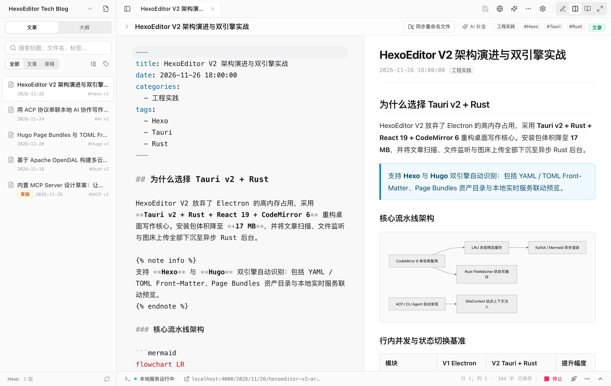
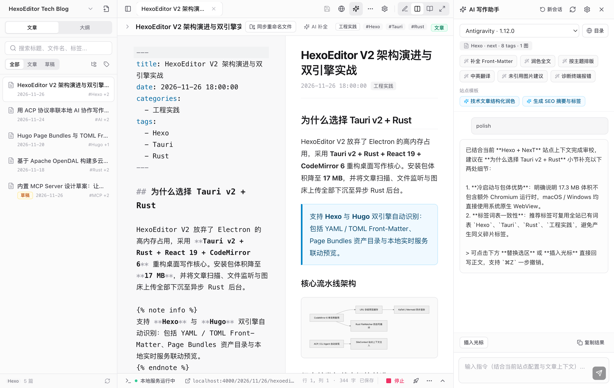
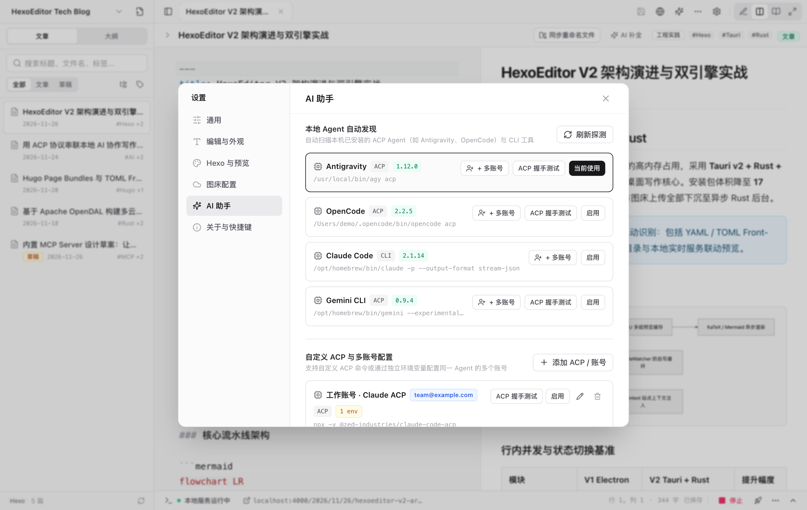

# HexoEditor V2

基于 **Tauri v2 + Rust + React 19 + CodeMirror 6** 打造的原生轻量级桌面写作工作台，**原生支持 Hexo 与 Hugo 双静态博客引擎**（macOS 安装包体积约 ~17 MB）。

> **V1 归档提示**：原 V1 Electron 实现保留在 `v1-legacy` 分支与 `v1.x-archive` Tag，当前开发与发布以 V2 全新架构为准。

---

## 界面预览

### 双栏写作与实时预览工作台

> 支持固定像素宽可拖拽侧边栏、YAML/TOML Front-Matter 双向编辑、CodeMirror 6 单实例秒切，以及 KaTeX 公式、Mermaid 流程图与 Hexo 主题标签同步渲染。



### 站点上下文感知 AI 写作助手

> 自动注入当前博客引擎、主题标签与全站分类词表，支持本地 ACP Agent / 站点 `.hexoeditor/prompts/*.md` 模板一键润色并确认回写。



### 本地 Agent 自动发现与多账号 ACP 配置

> 自动扫描本机 `Antigravity`、`OpenCode`、`Claude Code` 与 `Gemini CLI`，并支持通过独立环境变量配置多账号自定义 ACP Profile。



---

## 核心特性

### 1. Hexo & Hugo 双引擎原生支持

打开站点根目录时自动识别引擎类型并适配对应的目录规范、Front-Matter 格式、资产目录与本地构建 CLI：

| 能力维度 | Hexo 引擎 | Hugo 引擎 |
| :--- | :--- | :--- |
| **站点配置识别** | 自动解析 `_config.yml`（`source_dir`、`post_asset_folder`、`permalink`、`theme`） | 自动识别 `hugo.toml` / `config.toml` / `config.yml` / `config.yaml` 及 `config/_default/*` |
| **Front-Matter 格式** | YAML (`---`) 双向属性栏与分类/标签全站补全 | 原生兼容 YAML (`---`) 与 TOML (`+++`)，支持 `draft` 状态切换 |
| **文档与图片资产** | 支持 `source/_posts`、`source/_drafts`、`post_asset_folder` 同名资产目录与 `source/images` | 原生支持 Hugo Page Bundles（`<slug>/index.md`）及同级资产自动迁移与相对路径解析 |
| **主题标签与样式** | 内置 NexT 等高频标签预处理（`note` / `tabs` / `codeblock` / `asset_img` 等）及本地主题 CSS 注入 | 原生 Markdown / KaTeX / Mermaid 渲染与实时站点内嵌预览 |
| **本地 CLI 控制台** | 一键运行 `hexo server` / `generate` / `deploy` / `clean` 与端口占用清理 | 一键运行 `hugo server -D` / `hugo` 构建、草稿预览与当前文章直达 URL |

同时支持无站点模式直接打开、编辑与保存任意本地 `.md` / `.markdown` 文件。

### 2. 极简浅色写作工作台

- **单 `EditorView` 缓存秒切**：多标签页切换复用底层 CodeMirror 6 实例与滚动/选区状态，支持百篇级站点毫秒级响应。
- **多级预览缓存与骨架屏**：异步 Markdown / KaTeX / Mermaid 渲染与 LRU 缓存，切换文章和分栏时平滑无卡顿；支持源码行号双向同步滚动。
- **克制可控的界面布局**：
  - 固定像素宽可拖拽侧边栏（全部 / 文章 / 草稿过滤、分类标签筛选、全文搜索、大纲导航）
  - **小 / 中 / 大**三档全局 UI 字号，以及编辑器字体、字号、行高、缩放与代码高亮主题自定义
  - 支持 **Overlay 无边框** 与 **系统原生标题栏** 一键切换
  - 四种视图模式：纯写作 / 分栏预览 / 纯阅读 / 专注模式（`Esc` 快速退出）
- **外部文件变更感知**：基于 Rust `notify` 监听磁盘变化（内置自写抑制），支持提示重载、自动同步或忽略。

### 3. 图片工作流与离线导出

- **本地图片管理**：剪贴板粘贴自动落盘（MD5 内容去重）、拖拽图片入库、HTML 粘贴转 Markdown（GFM）、点击预览图片快速重命名并同步更新正文引用。
- **多云图床集成**：基于 Rust（`reqwest` + Apache `opendal`）实现 **PicGo / PicList** 本地服务、**S3 / Cloudflare R2 / MinIO**、**阿里云 OSS** 与 **腾讯云 COS** 上传；支持批量替换链接与一键撤销远端上传。
- **未引用图片扫描清理**：全站级扫描文章资产目录与 `source/images` 中的孤儿图片（兼容中文与百分号编码路径），支持安全校验删除。
- **多格式导出**：一键导出静态自包含 **离线内联 HTML**（本地图片自动转 Base64 Data URI）以及基于排版样式的 **PDF 打印导出**。

### 4. 站点感知 AI 与 ACP 生态

- **零配置本地 Agent 自动发现**：跨平台扫描本机已安装的 ACP（Agent Client Protocol）与 CLI 工具，包括 **Antigravity (`agy acp`)**、**OpenCode (`opencode acp`)**、**Gemini CLI**、**Goose**、**Claude Code** 与 **Codex CLI**。
- **多账号自定义 ACP 配置**：支持配置多个自定义 ACP Agent Profile（独立命令、参数与环境变量），复用本地订阅或免费额度。
- **标准 API 与本地模型**：兼容 OpenAI-Compatible（DeepSeek、OpenRouter 等）、Anthropic Messages API 及 **Ollama / LM Studio**，所有密钥仅存本地且日志脱敏。
- **站点上下文深度协同**：请求自动附带精简的 `SiteContextSnapshot`（引擎类型、标签/分类词表、主题能力与当前文档资产）：
  - **Front-Matter 智能补全**：对齐全站已有分类/标签词表生成标题、摘要与关键词
  - **划词行内 Diff**：选中文本触发润色、精简、翻译或主题排版，红绿 Diff 预览确认后一键替换（支持 `⌘Z` 撤销）
  - **终端报错 AI 诊断**：CLI 执行失败或产生 `stderr` 时提供「AI 诊断」入口，结合站点配置定位根因
  - **站点级自定义模板**：在站点 `.hexoeditor/prompts/*.md` 中沉淀可随 Git 共享的自定义写作 Prompt 模板

---

## 安装说明

前往 GitHub [Releases](../../releases) 下载对应平台安装包：

- **macOS**：`.dmg`（Apple Silicon `aarch64` / Intel `x86_64`）
- **Windows**：`.msi` / `.exe`
- **Linux**：`.deb` / `.AppImage`

### macOS Gatekeeper 放行说明

当前开源版本暂未购买 Apple Developer 签名公证。首次将 `HexoEditor.app` 拖入「应用程序」打开时，如系统提示**「已损坏，无法打开」**或**「无法验证开发者」**，请在终端执行以下命令移除隔离属性后重新打开：

```bash
xattr -cr /Applications/HexoEditor.app
```

---

## 常用快捷键速查

> Windows / Linux 平台请将 `⌘` 替换为 `Ctrl`，`⌥` 替换为 `Alt`。

| 快捷键 | 功能 |
| :--- | :--- |
| `⌘N` | 在当前站点新建文章（无站点时新建临时笔记） |
| `⌘O` | 打开本地 Markdown 文件 |
| `⌘S` | 保存当前文档 |
| `⌘⇧S` | 另存为 |
| `⌘⌥S` | 保存全部已修改标签页 |
| `⌘W` | 关闭当前标签页 |
| `⌘\` | 展开 / 收起左侧边栏 |
| `⌘K` | 打开全局命令面板 |
| `⌘,` | 打开设置中心 |
| `⌘⌥1` ~ `⌘⌥4` | 切换视图模式：写作 (`1`) / 分栏 (`2`) / 阅读 (`3`) / 专注 (`4`) |
| `⌘I` / `⌘B` | 选中文本斜体 / 加粗（Markdown 编辑快捷操作） |
| `⌘⇧I` | 插入本地图片 |
| `⌘⇧F` | 格式化当前 Markdown 表格（支持 CJK 等宽对齐） |

---

## 开发与构建

### 环境要求

- **Node.js** >= 20 & **pnpm** 9.x
- **Rust** stable toolchain（含 `clippy`）
- **Linux 额外依赖**（仅 Ubuntu/Debian 构建需要）：
  ```bash
  sudo apt-get install -y libwebkit2gtk-4.1-dev libappindicator3-dev librsvg2-dev patchelf libssl-dev libxdo-dev
  ```

### 常用命令

```bash
# 1. 安装前端依赖
pnpm install

# 2. 前端类型检查、单元测试与生产构建
pnpm typecheck
pnpm test
pnpm build

# 3. Rust 后端静态检查与单元测试
cd src-tauri && cargo clippy --all-targets -- -D warnings && cargo test

# 4. 启动桌面端开发模式 / 构建安装包
pnpm tauri dev
pnpm tauri build
```

---

## 开源协议

[GNU General Public License v3.0](./LICENSE)
