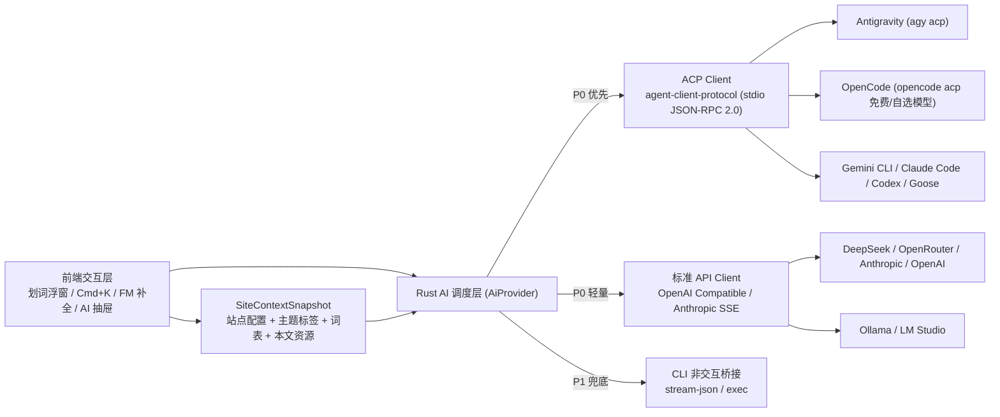

# HexoEditor V2 AI / ACP 与站点感知写作助手架构设计

> **状态**：设计草案（面向 V2 Phase 4 演进）
> **目标**：在不破坏 HexoEditor V2「极简浅色写作台、~16 MB 轻量原生体积」的前提下，统一接入 **ACP 协议（复用本地 Agent 与订阅/免费额度）**、**标准模型 API** 与 **本地 CLI 桥接**，并提供**站点配置感知（Site-Aware）的内置提示词与编辑器内辅助能力**。

---

## 一、定位与设计原则

1. **站点感知的写作副驾，而非通用聊天外壳**：所有 AI 请求自动携带精简后的博客工程上下文（站点引擎、主题配置、Permalink 规则、已有标签/分类词表、当前 Front-Matter 与同级资产清单），输出直接贴合 Hexo / Hugo 的真实规范。
2. **极简渐进式 UI（遵循 K.I.S.S.）**：默认界面不常驻重型聊天侧栏；仅通过 **划词悬浮操作 / `Cmd+K` 命令面板 / Front-Matter 一键补全 / 可折叠右侧辅助抽屉** 按需触发。
3. **协议与生态复用优先**：不自造专有 Agent 通信协议，直接采用 **Agent Client Protocol（ACP）** 作为第一等接入标准，复用成熟开源 SDK 与注册表体系。
4. **最小权限与可撤销闭环**：对正文的改动优先通过 CodeMirror 6 **Inline Diff / 确认应用**（支持一键撤销 `Cmd+Z`），ACP Agent 对站点目录的写入/命令执行默认受限于当前站点根路径并通过权限回调确认。

---

## 二、总体架构与三类统一接入模式（`AiProvider`）

在 Rust 后端建立统一的 `AiProvider` 调度层，前端仅消费统一流式事件（文本增量、推理片段、工具/权限请求、错误与额度状态）：



### 三类接入模式对比

| 接入模式 | 适用场景 | 典型对接对象 | 核心优势 | 优先级 |
| :--- | :--- | :--- | :--- | :--- |
| **1. ACP 协议接入** | 整篇重构、按主题规范排版、排查 `hexo g/s` 报错、多步骤检索站点 | **Antigravity (`agy acp`)**、**OpenCode (`opencode acp`)**、Gemini CLI (`--experimental-acp`)、Claude Code ACP、Codex ACP、Goose (`goose acp`) | 直接复用用户本地订阅与免费额度（如 OpenCode 内置免费模型、Antigravity Agent 能力），无需重复粘贴 API Key；天然支持 Session、工具调用与权限边界 | **P0** |
| **2. 标准 API 直连** | 划词润色、翻译、起标题、摘要/标签生成、短文本改写 | OpenAI-Compatible（DeepSeek、OpenRouter、硅基流动、OneAPI）、Anthropic Messages API、Ollama / LM Studio | 首字延迟极低（百毫秒级）、不拉起子进程、支持纯离线本地模型 | **P0** |
| **3. CLI 订阅桥接** | 暂未升级原生 ACP 的本地订阅制 CLI 工具 | `claude -p --output-format stream-json`、`codex exec` 等非交互模式 | 作为过渡兜底，保证已购买命令行订阅的用户开箱可用 | **P1** |

---

## 三、本地 Agent 自动发现、能力探测与开源参考

### 3.1 跨平台自动发现流程

直接复用现有 [hexo_cli.rs](file:///Users/zac/code/github/HexoEditor/src-tauri/src/hexo_cli.rs) 中的 `build_candidate_path_dirs` 跨平台扫描框架（Node 版本管理器、Homebrew、`~/.local/bin` 等），并扩展常见 Agent 安装目录（`~/.opencode/bin`、`~/.cargo/bin`、`~/.volta/bin`、`~/.npm-global/bin`）：

1. **静态可执行文件探测（已完成本机环境验证）**：
   在本机实测中，以下本地工具均可直接扫描识别：
   - **OpenCode (`~/.opencode/bin/opencode`, `v2.2.5`)**：内置 `opencode acp`，支持直接启动 ACP stdio 服务。
   - **Antigravity (`~/.local/bin/agy`, `1.5.17`)**：内置 `agy acp`，支持 ACP stdio 服务与本地/远程 Agent 模式。
   - **其他常见 CLI**：如 `claude`、`codex`、`cursor-agent`、`gemini`、`goose` 等，按优先级匹配原生 ACP 参数或 CLI 桥接适配器。
2. **结合 ACP Registry 目录**：
   启动设置页拉取（或回退到内置离线快照）官方注册表 `cdn.agentclientprotocol.com/registry/v1/latest`，自动识别已知 Agent 的标准启动命令、参数与所需环境变量，降低手工配置门槛。
3. **动态能力握手（Capability Negotiation）**：
   Rust 后端拉起子进程后，通过 ACP `initialize` 握手实时读取 `agentCapabilities`（支持模型列表、Session 复用、`loadSession`、流式输出、MCP 挂载、文件系统/终端能力），据此在 UI 上动态点亮或降级按钮，避免硬编码功能开关。

### 3.2 可参考与复用的成熟开源体系

| 类别 | 开源项目 / SDK | 复用方式 |
| :--- | :--- | :--- |
| **协议与 Rust 核心** | `agentclientprotocol/agent-client-protocol`（Rust crate：`agent-client-protocol`、`agent-client-protocol-schema`） | 直接用于 `src-tauri` 实现类型安全的 ACP Client 与 stdio JSON-RPC 2.0 Framing |
| **TypeScript 类型与参考** | `@agentclientprotocol/sdk` | 参考前后端事件 Schema 映射与 Session 状态机设计 |
| **Agent 注册表** | `agentclientprotocol/registry` | 作为内置 Agent 目录数据源，支撑零配置探测与一键启用 |
| **标杆编辑器实现** | Zed（Agent Panel） | 参考 ACP 权限审批卡片、Tool Call 状态流与子进程生命周期管理 |
| **Tauri + ACP 桌面端参考** | `Troupe`、`Plyfold`、`acp-ui`、`AeroWork` | 参考 Tauri 环境下 Rust `tokio::process::Command` 托管多个 ACP 子进程及事件转发模式 |

---

## 四、核心亮点：站点感知上下文与内置提示词体系

不同于普通 Markdown 编辑器的「盲目改写」，HexoEditor 掌握完整站点配置与内容图谱，可构建精简的 **`SiteContextSnapshot`（控制约 1–2 KB Token）** 随请求自动注入：

### 4.1 `SiteContextSnapshot` 上下文结构

```ts
export interface SiteContextSnapshot {
  engine: "hexo" | "hugo";
  siteTitle: string;
  language: string;           // 如 zh-CN / en
  permalink: string;          // 如 :year/:month/:day/:title/
  postAssetFolder: boolean;   // 图片路径规范：true 且 postAsset=true 时优先裸文件名 img.png
  markdownConfig?: {
    breaks?: boolean;
    mathEnabled?: boolean;    // 主题是否已开启 mathjax / katex
    mermaidEnabled?: boolean; // 主题是否已开启 mermaid + highlight exclude
  };
  enabledThemeTags: string[]; // 探测到的可用标签，如 note / tabs / codeblock / blockquote
  existingCategories: string[];
  existingTags: string[];     // 全站高频标签词表，防止 AI 造出重复近义词标签
  activeDoc: {
    filePath: string;
    isDraft: boolean;
    frontMatter: Record<string, unknown>;
    localImages: string[];    // 同级资产目录下可用图片名（如 architecture.png）
  };
}
```

### 4.2 六大内置场景化提示词能力

| 场景入口 | 触发方式 | 注入的站点上下文 | 预期输出 |
| :--- | :--- | :--- | :--- |
| **1. Front-Matter 智能补全与词表对齐** | Front-Matter 栏「AI 补全」按钮 / `Cmd+K` | 全站 `existingTags`、`existingCategories`、站点 `language`、正文内容 | 生成规范 `title`、`abbrlink`/slug、`description`、`<!-- more -->` 摘要断点，并优先从已有词表挑选标签 |
| **2. 站点主题排版升级** | `Cmd+K` / AI 抽屉「按当前主题优化排版」 | `enabledThemeTags`、`mathEnabled`、`mermaidEnabled` | 仅使用当前站点已启用的标签重写或增强结构（例如将普通引用升级为 NexT `` / ``；未开启的标签绝不滥用） |
| **3. 资产图片检查与配文生成** | 图片管理弹窗 / 编辑器 | `postAssetFolder`、`activeDoc.localImages`、正文引用 | 发现「已放入资产目录但未引用的图片」并建议插入位置；按站点规范自动生成标准写法（如 `` 或 ``）与 Alt 描述 |
| **4. 编辑器划词行内润色（Inline Diff）** | CodeMirror 6 选中文本悬浮菜单 / `Cmd+I` | 前后文邻近段落 + 站点语言风格 | 支持精简、技术表达优化、中英互译、转表格/Mermaid 流程图；结果在编辑器内先展示 Diff，确认后应用并可 `Cmd+Z` 撤回 |
| **5. 终端报错与配置诊断** | 底部终端出现 `stderr` 时展示「AI 诊断」按钮 | `_config.yml`、`_config.next.yml`、最近 50 行终端日志 | 直接定位例如「`mathjax` 未在主题配置开启」「`post_asset_folder` 路径写法冲突」「端口占用/插件缺失」并给出可复制修改片段 |
| **6. 站点级自定义 Prompt 模板** | 站点目录 `.hexoeditor/prompts/*.md` | 支持 `{{site.*}}`、`{{doc.*}}` 占位符 | 允许作者沉淀个人写作风格（如周报体、技术评测模板），项目内随 Git 共享 |

---

## 五、代码模块规划（贴合 V2 现有架构）

遵循 V2「Rust 负责本地能力、安全与网络；React + Zustand 负责视图与轻量状态」的边界划分：

- **Rust 端（`src-tauri/src/ai/`）**：
  - `mod.rs`：对外暴露 Tauri Commands（`discover_local_agents`、`test_ai_connection`、`ai_chat_stream`、`ai_cancel`、`ai_respond_permission`）与 `AiRuntimeState` 托管。
  - `discovery.rs`：跨平台扫描本地 CLI 与 ACP Agent，读取版本与探测结果（复用 `hexo_cli.rs` PATH 逻辑）。
  - `acp_client.rs`：基于 `agent-client-protocol` crate 管理子进程（带 `process_group(0)` 与退出清理），实现 `initialize`、`session/new`、`session/prompt`、权限请求转发及流式增量事件下发。
  - `api_client.rs`：复用 `reqwest` 实现 OpenAI-Compatible 与 Anthropic SSE 流式请求；延续 `image_bed.rs` 的密钥脱敏原则，日志与前端状态绝不回显明文 Token。
  - `context.rs`：从当前站点 `_config.yml`、主题配置及扫描缓存提取 `SiteContextSnapshot`。
- **前端（`src/lib/ai/` 与 `src/components/ai/`）**：
  - `src/lib/ai/prompts.ts`：内置 6 类场景提示词模板与 Token 预算裁剪器（正文超长时仅附带大纲 + 选中区上下文）。
  - `src/components/ai/InlineAiPopover.tsx`：CodeMirror 6 划词悬浮条与行内 Diff 预览确认。
  - `src/components/ai/AiAssistantDrawer.tsx`：按需展开的极简右侧辅助抽屉（切换已发现的 ACP Agent / API 模型、展示推理与工具调用状态）。
  - `src/components/settings/SettingsDialog.tsx`：新增「AI 与 Agent」页签（自动发现列表、ACP/API/CLI 三模式切换与连通性测试）。

---

## 六、分期路线与待决策事项

### 分期落地建议

| 阶段 | 交付范围 | 验收标准 |
| :--- | :--- | :--- |
| **Phase 4A（MVP 闭环）** | 本地 Agent 自动发现 + Rust ACP Client（优先实机打通 **`agy acp`** 与 **`opencode acp`**）+ OpenAI 兼容 API SSE + `SiteContextSnapshot` + Front-Matter 补全 + 划词润色确认替换 | 不配置 API Key 即可调用本机 `opencode` / `agy` 完成一篇文章的摘要标签补全与段落润色 |
| **Phase 4B（站点深度协同）** | 右侧极简可折叠 AI 抽屉 + 主题标签自动排版 + 终端报错一键诊断 + `.hexoeditor/prompts` 自定义模板 + 在线 ACP Registry 拉取 | 站点存在未启用功能或渲染报错时，能结合真实 `_config.yml` 给出精准修复方案 |

### 需要后续拍板的 3 个轻决策

1. **开发顺序优先级**：在「Hexo 全流程验证」完成之后，先做 **Hugo 引擎适配**（盘活你的个人主力博客与泛用性）还是先做 **Phase 4A AI/ACP 接入**？
2. **密钥存储方式**：标准 API Key 是继续沿用本地配置文件存储（与当前图床配置一致），还是升级统一接入 macOS Keychain（`keyring` crate）？
3. **正文改写交互形态**：划词或整篇辅助时，优先采用 **编辑器行内绿/红 Diff 确认框**，还是 **右侧抽屉对比后点「应用到正文」**？
